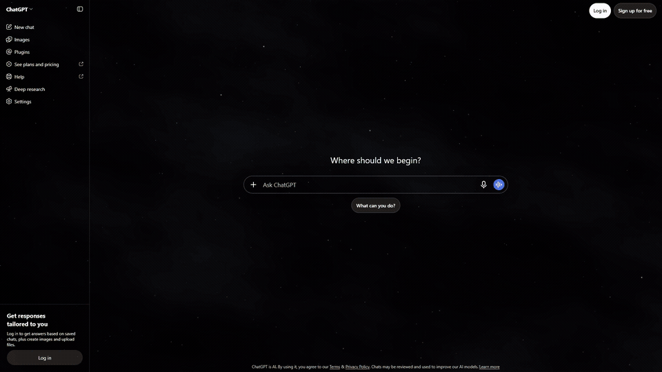
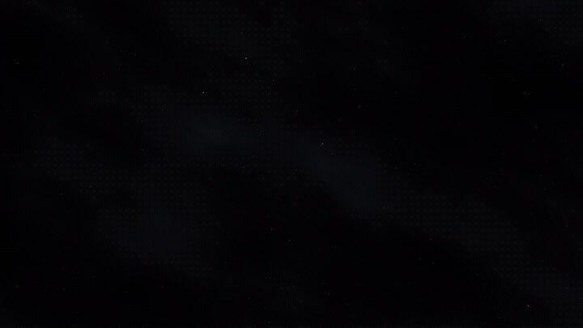
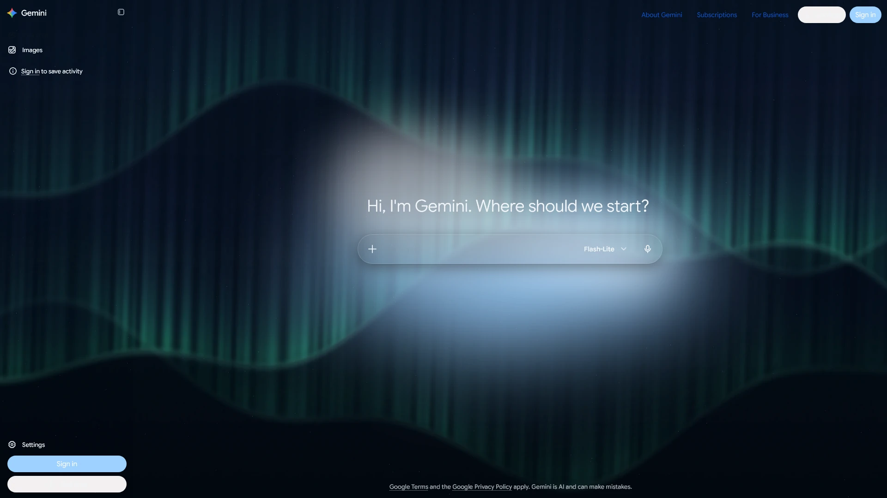
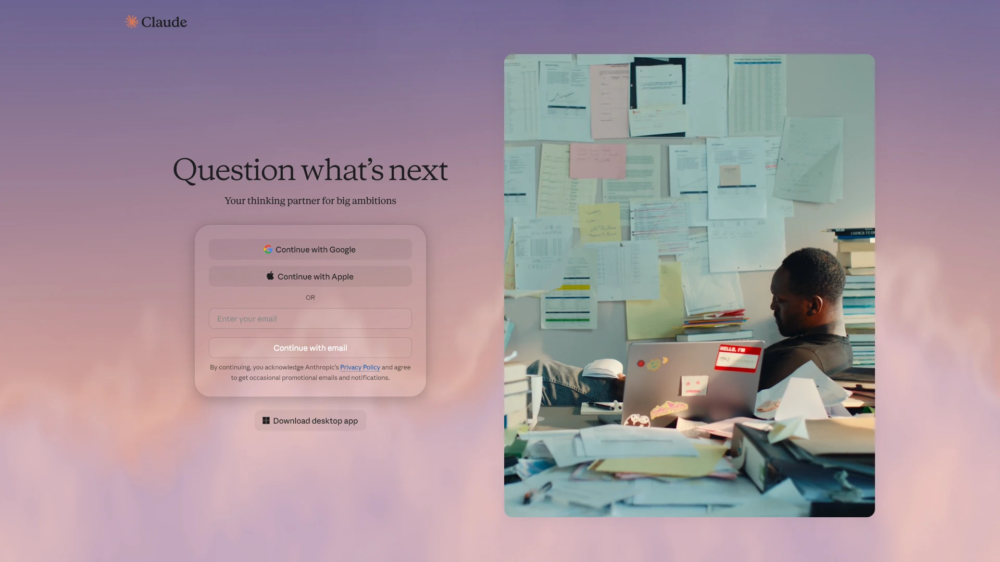
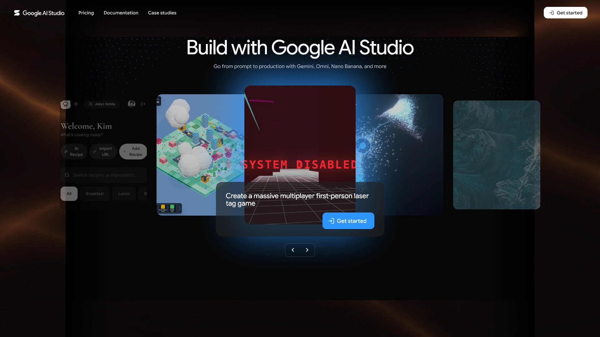
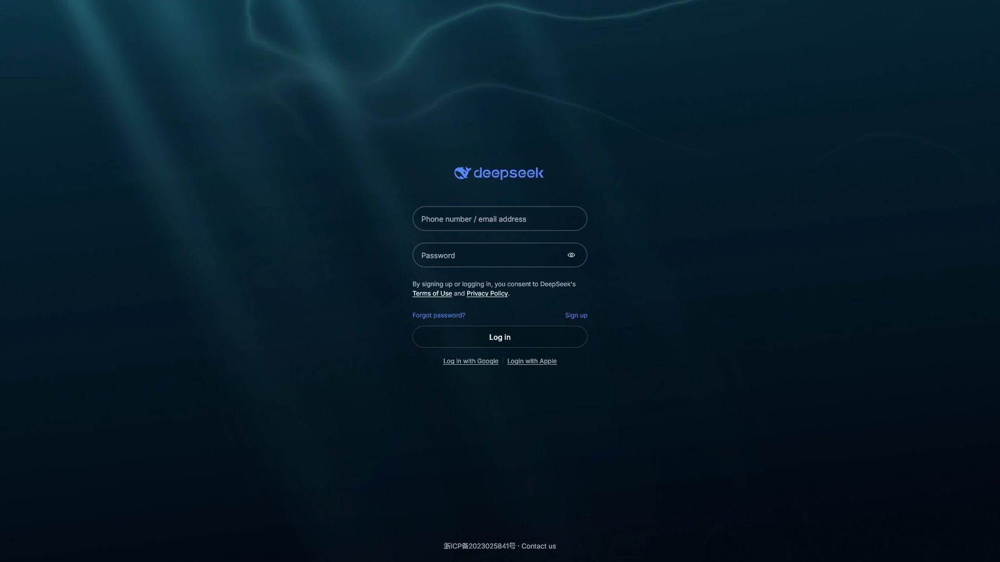

# Aurora Universal

Liquid glass and image or video backgrounds for AI websites. Built for Firefox.

[](https://github.com/pigeonIabs/AuroraUniversal/releases/download/v1.0.1/aurora-universal-launch.mp4)

[](https://github.com/pigeonIabs/AuroraUniversal/releases/download/v1.0.1/aurora-space-timelapse.mp4)

[](https://github.com/pigeonIabs/AuroraUniversal/releases/download/v1.0.1/aurora-animated-gradient.mp4)

 
 

## Features

- Glass transparency, light and dark themes, and bundled reading fonts
- Automatically shared settings with individual website customizations
- Image and video backgrounds, including files stored in your browser
- Space, Northern Lights, Dawn, Ember, Deep Ocean, and other built-in backgrounds
- Focus mode, cinema width, history blur, and sensitive text masking
- Message queues and preferred models on supported chat pages
- Separate controls for promotions, usage notices, and AI disclaimers
- ChatGPT sponsored-placement hiding, enabled by default

Preferences use browser storage and Firefox Sync. Uploaded backgrounds stay local. [Privacy details](PRIVACY.md).

## Websites

[ChatGPT](https://chatgpt.com) · [Claude](https://claude.ai) · [Gemini](https://gemini.google.com) · [Grok](https://grok.com) · [Qwen](https://chat.qwen.ai) · [Google AI Studio](https://aistudio.google.com) · [DeepSeek](https://chat.deepseek.com) · [Hugging Face](https://huggingface.co)

## Download

Get the release files from [GitHub Releases](https://github.com/pigeonIabs/AuroraUniversal/releases/latest). The development XPI is unsigned. [Firefox Add-ons](https://addons.mozilla.org/en-US/firefox/addon/aurora-universal/) is awaiting review. [Release notes](release/RELEASE_NOTES.md).

## Install from source

In Firefox, open `about:debugging#/runtime/this-firefox`, choose **Load Temporary Add-on**, and select `manifest.json`. Open a supported website, then use the Aurora toolbar button.

To build an XPI with Python 3.9 or later, run this from the project folder.

```sh
python scripts/build_xpi.py
```

The package is written to `build/aurora-universal-1.0.1.xpi`. Standard Firefox requires a [Mozilla-signed package](https://extensionworkshop.com/documentation/publish/signing-and-distribution-overview/) for permanent installation. Unsigned development packages require a browser configured to accept them.

[Development](DEVELOPMENT.md) · [Privacy](PRIVACY.md) · [AGPLv3 license](LICENSE) · [Third-party notices](THIRD_PARTY_NOTICES.md)
