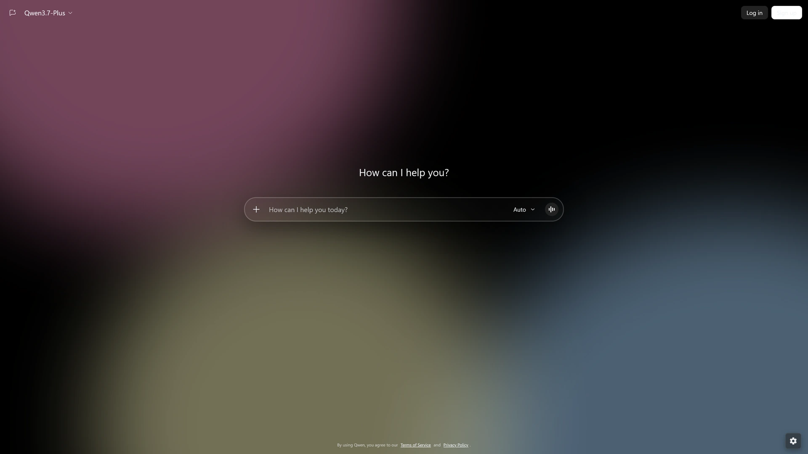

# Aurora Universal

Glass, backgrounds, and a quieter workspace for the AI sites you use. Built for Firefox.



Aurora changes the material of the interface while keeping each site's layout and controls familiar. Adjust transparency, choose an image or video background, and bring the same atmosphere to eight AI platforms.

## Make it yours

- Glass transparency, light and dark themes, and bundled reading fonts
- Image and video backgrounds, including files stored in your browser
- Focus mode, cinema width, history blur, and sensitive text masking
- Message queues and preferred models on supported chat pages
- Separate controls for promotions, usage notices, and AI disclaimers
- ChatGPT sponsored-placement hiding, enabled by default

Settings show the features available on the current website. Preferences stay in browser storage, with Firefox Sync available for preferences. Uploaded backgrounds stay local. [Privacy details](PRIVACY.md).

## Eight websites

| Website | Coverage |
| --- | --- |
| [ChatGPT](https://chatgpt.com) | Chats, projects, settings, and the web app |
| [Claude](https://claude.ai) | Chats and native model selection |
| [Gemini](https://gemini.google.com) | Chats, Gems, Connected Apps, Labs, and media pages |
| [Grok](https://grok.com) | Chats and native model selection |
| [Qwen](https://chat.qwen.ai) | Chats, My Library, and My Published |
| [Google AI Studio](https://aistudio.google.com) | Prompts, apps, live, media, and library |
| [DeepSeek](https://chat.deepseek.com) | Chats |
| [Hugging Face](https://huggingface.co) | Hub, models, datasets, Spaces listings, and HuggingChat |

## Version 1.0.0

This is the first Aurora Universal release, following the original Aurora for ChatGPT. The earlier `1.8.*` development numbering belongs to that transition. Universal starts at `1.0.0`.

Get the release files from [GitHub Releases](https://github.com/pigeonIabs/AuroraUniversal/releases/tag/v1.0.0). The development XPI is unsigned. A Firefox Add-ons listing is being submitted separately. [Release notes](release/RELEASE_NOTES.md).

## Install from source

In Firefox, open `about:debugging#/runtime/this-firefox`, choose **Load Temporary Add-on**, and select `manifest.json`. Open a supported website, then use the Aurora toolbar button.

To build an XPI with Python 3.9 or later, run this from the project folder.

```sh
python scripts/build_xpi.py
```

The package is written to `build/aurora-universal-1.0.0.xpi`. Standard Firefox requires a [Mozilla-signed package](https://extensionworkshop.com/documentation/publish/signing-and-distribution-overview/) for permanent installation. Unsigned development packages require a browser configured to accept them.

Universal uses a new extension ID and installs separately from Aurora for ChatGPT LibreWolf. Export preferences from the old extension's settings, import them into Universal, then disable the old extension to avoid overlapping styles. Uploaded backgrounds need to be selected again. [Migration details](release/MIGRATION.md).

[Development](DEVELOPMENT.md) · [Privacy](PRIVACY.md) · [AGPLv3 license](LICENSE) · [Third-party notices](THIRD_PARTY_NOTICES.md)
